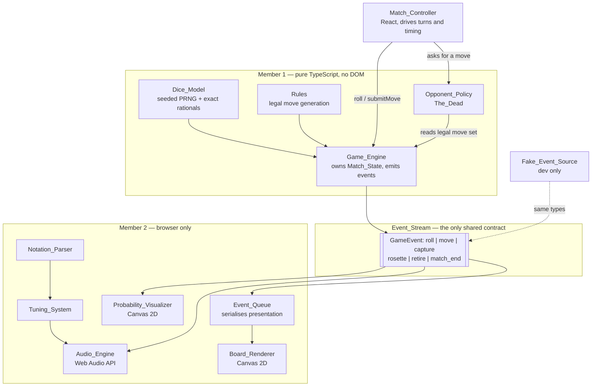
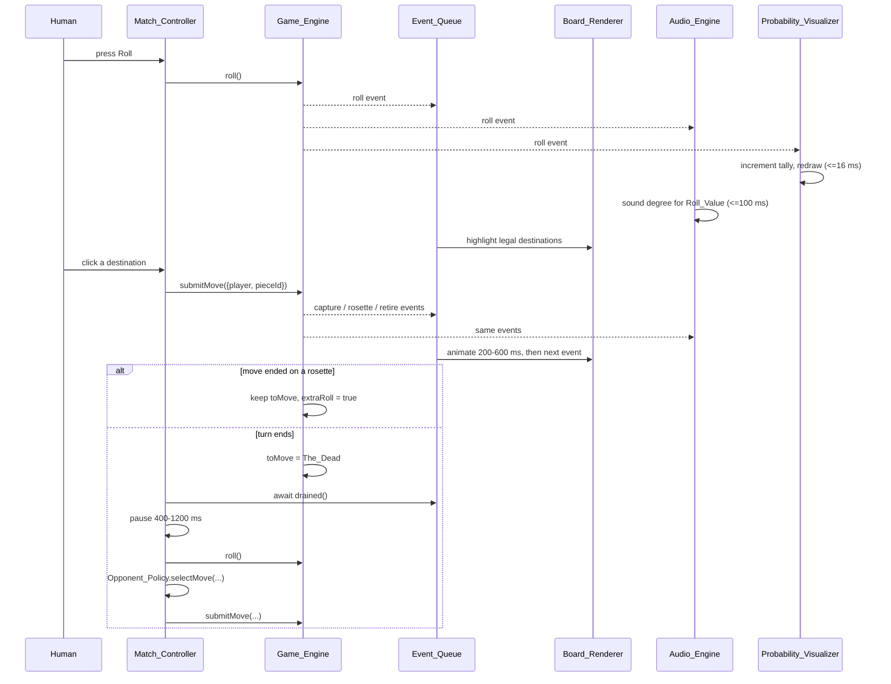
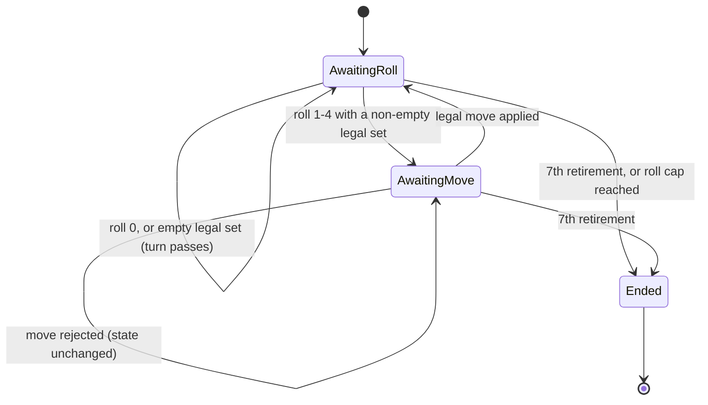

# Design Document

## Overview

KUR is a static browser application: a playable reconstruction of the Royal Game of Ur under the Finkel_Ruleset, a run-time synthesiser driven by the interval notation of Hurrian Hymn no. 6, and a live view of the B(4, 1/2) dice distribution. This document designs the system that two developers can finish between 3 November and the internal freeze of 27 November 2026.

### MVP scope declaration

The requirements document specifies 20 requirements. This design implements a subset in full and leaves the rest as named extension points. The cut is deliberate: a complete, polished vertical slice beats twenty half-features in a 31-day window with two people.

**In the MVP, designed to implementable detail:**

| Requirement | Why it is in |
|---|---|
| 1–8 Game_Engine (board, dice, legal moves, rosettes, capture, retirement, The_Dead, Event_Stream) | The core. Everything else consumes it. Not negotiable. |
| 9 Notation_Parser, minimal form | The Audio_Engine cannot exist without an Interval_Sequence. |
| 10 Tuning_System and synthesis | The second resurrected artefact. This is the differentiator of the submission. |
| 11 Audio response to the match | Makes the game and the hymn one system instead of a game with background music. |
| 12 Probability_Visualizer | The teaching claim of the project lives here. |
| 15 Board_Renderer and art direction | Design is a scored criterion; the board is what the video shows. |
| 17 Deployment to a public URL | A submission rule, not a feature. |
| 19.1, 19.2, 19.6 audio degradation | Browsers block audio until a user gesture. Without this the demo breaks on a judge's machine. |

**Deferred, with extension points recorded in the final section:** Requirement 13 (Prediction_Mode), 14 (Match_Summary), 16 (full accessibility beyond mute and reduced motion), 18 (Provenance_Panel), 20 (Match_Record and local storage).

### Research notes informing the design

- **Property-based testing library.** [fast-check](https://github.com/dubzzz/fast-check) is the established property-based testing framework for TypeScript, modelled on QuickCheck, and is test-runner agnostic, working with Vitest without special integration ([registry summary](https://tessl.io/registry/testland/fast-check-testing)). A first-party binding, [`@fast-check/vitest`](https://classic.yarnpkg.com/en/package/@fast-check/vitest), extends Vitest's `test` with reproducible randomness, which is what we want for failures that can be replayed from a seed. Decision: **Vitest as runner, `fast-check` for properties, `@fast-check/vitest` for the binding.** Content rephrased for compliance with licensing restrictions.
- **Interval notation, not pitches.** The cuneiform notation of the hymn names intervals, so no absolute frequency is attested. The design therefore separates `Interval_Sequence` (data, citable) from `Tuning_System` (modern choice of tonic and octave register, labelled as reconstruction).
- **Board geometry.** The 20 squares are a 3×8 grid with four squares absent: the outer rows hold columns 0–3 and 6–7, the middle row holds all eight columns. This yields 6 + 8 + 6 = 20 and makes the 14-position path fall out of the grid without special cases.

### Design principles

1. **The engine is pure.** `src/engine/` imports no DOM API and no React. It plays a complete match in Node. This is what makes Requirement 8.4 testable and property testing cheap.
2. **One contract between two developers.** The Event_Stream types are the only shared surface. Member 2 builds against a fake event generator from day one and never reads `MatchState`.
3. **Exact arithmetic where the teaching claim lives.** Dice probabilities are rationals, never decimals. Interval ratios are integer pairs, never floats, until the final frequency computation.
4. **Degrade, never crash.** Every failure path keeps the match playable: audio can be absent, the hymn can fail to parse, the renderer can fall behind. The game still finishes.

---

## Architecture

### Component graph



Arrows into the engine are commands; arrows out are events. No presentation component has a reference to `MatchState`.

### Turn flow



Two timing rules come out of this diagram. First, the controller waits for `Event_Queue.drained()` before the next roll, which is how Requirement 15.7 (render events in order, one at a time) and Requirement 7.4 (a readable pause after The_Dead moves) stay compatible. Second, the Audio_Engine and the Probability_Visualizer subscribe directly rather than through the queue, because both must react within 100 ms and neither animates.

### Engine phase machine



`roll()` resolves the degenerate turns itself: a Roll_Value of 0 or an empty legal move set emits the `roll` event, passes the turn and returns to `AwaitingRoll` without emitting a `move` event (Requirements 3.1, 3.6, 4.4).

### Repository layout

```
/
  index.html
  package.json
  vite.config.ts
  tsconfig.json                 # strict: true, noUncheckedIndexedAccess: true
  vitest.config.ts
  .github/workflows/deploy.yml  # build + publish to GitHub Pages
  src/
    engine/                     # MEMBER 1. No DOM, no React imports.
      types.ts                  # MatchState, Move, Rejection, Result
      events.ts                 # GameEvent union — THE shared contract
      rational.ts               # exact Rational arithmetic
      board.ts                  # square ids, paths, rosettes
      dice.ts                   # Dice_Model + seeded PRNG
      rules.ts                  # legalMoves(state, rollValue), applyMove
      engine.ts                 # createEngine(): phases, emission, roll cap
      opponent.ts               # Opponent_Policy
      index.ts                  # public surface of the library
    audio/                      # MEMBER 2
      notation.ts               # Notation_Parser + Notation_Printer
      tuning.ts                 # Tuning_System
      audioEngine.ts            # voices, envelopes, event mapping
      degreeMap.ts              # event kind / Roll_Value -> degree
    render/                     # MEMBER 2
      theme.ts                  # the declared visual system
      boardRenderer.ts
      probabilityVisualizer.ts
      eventQueue.ts             # serialises presentation of events
    app/                        # MEMBER 2, with M1 on the controller
      App.tsx
      MatchController.ts        # turn driving, pauses, audio unlock
      components/               # Controls, AudioGate, Fallback
    data/
      hymn-h6.kur               # bundled Hymn_Notation document
    devtools/
      fakeEventSource.ts        # scripted + random GameEvent generator
  tests/
    engine/*.test.ts            # examples
    engine/*.prop.test.ts       # properties
    audio/*.prop.test.ts
    smoke/headless-match.test.ts# full match in Node, asserts no DOM use
```

### How two people work without blocking each other

`src/engine/events.ts` is written first, on day one, and both developers agree on it before anything else is built. Member 2 then develops against `src/devtools/fakeEventSource.ts`, which emits the same `GameEvent` union from a scripted array and from a random walk, so the Audio_Engine, the Board_Renderer and the Probability_Visualizer can be finished and tuned before the engine is done. The dev build exposes a toggle between the real engine and the fake source. Because no presentation component may read `MatchState`, swapping the source is a one-line change and the fake source doubles as the test fixture for render and audio tests.

---

## Components and Interfaces

### Shared contract: the Event_Stream

```ts
// src/engine/events.ts
export type PlayerId = 'human' | 'dead';
export type PieceId = 0 | 1 | 2 | 3 | 4 | 5 | 6;
export type RollValue = 0 | 1 | 2 | 3 | 4;
/** Path position, 1..14. Validated at construction, carried as number. */
export type PathPos = number;
export interface Rational { readonly num: number; readonly den: number }

export type EventKind = 'roll' | 'move' | 'capture' | 'rosette' | 'retire' | 'match_end';

interface EventBase {
  readonly kind: EventKind;
  /** Consecutive from 1 within a match, no gaps, no repeats (Req 8.1). */
  readonly seq: number;
  /** The player the event belongs to (Req 8.2). */
  readonly player: PlayerId;
}

/** Req 8.7 */
export interface RollEvent extends EventBase {
  readonly kind: 'roll';
  readonly rollValue: RollValue;
  readonly probability: Rational;           // exact, from the Dice_Model
  readonly extraRoll: boolean;              // granted by a rosette
  readonly rollCount: number;               // rolls this match, including this one
  readonly legalMoves: readonly LegalMoveSummary[];
}
export interface LegalMoveSummary {
  readonly from: 'hand' | PathPos;
  readonly to: PathPos | 'retire';
}

/** Req 8.8. Retirement does not emit a move event; see Decision D4. */
export interface MoveEvent extends EventBase {
  readonly kind: 'move';
  readonly pieceId: PieceId;
  readonly from: 'hand' | PathPos;
  readonly to: PathPos;                     // always 1..14
  readonly traversed: readonly PathPos[];   // ordered, excludes the origin
  /** Pieces of each player standing on a non-rosette Shared_Square after the move. */
  readonly exposedOnShared: Readonly<Record<PlayerId, number>>;
}

/** Req 8.9 */
export interface CaptureEvent extends EventBase {
  readonly kind: 'capture';                 // player = the capturing player
  readonly pathPos: PathPos;                // the Shared_Square of the capture
  readonly capturedPlayer: PlayerId;
  readonly capturedPieceId: PieceId;
  readonly handCountAfter: number;          // 1..7, of the player losing the piece
}
export interface RosetteEvent extends EventBase {
  readonly kind: 'rosette';
  readonly pathPos: PathPos;
  readonly grantedTo: PlayerId;
}
export interface RetireEvent extends EventBase {
  readonly kind: 'retire';
  readonly pieceId: PieceId;
  readonly from: PathPos;                   // square the piece left, for the animation
  readonly retiredCountAfter: number;       // 1..7
}
export interface MatchEndEvent extends EventBase {
  readonly kind: 'match_end';
  readonly winner: PlayerId;
  readonly reason: 'all_retired' | 'roll_cap';
  readonly rollCount: number;
  readonly rollTally: readonly [number, number, number, number, number];
  readonly captureCount: number;
}

export type GameEvent =
  | RollEvent | MoveEvent | CaptureEvent | RosetteEvent | RetireEvent | MatchEndEvent;

export type EventConsumer = (event: GameEvent) => void;
export type Unsubscribe = () => void;
```

Every emitted event is deep-frozen before delivery, so a consumer cannot mutate what another consumer sees (Requirement 8.3). Delivery is synchronous, in registration order, over a snapshot of the consumer list taken at emission, and completes for all consumers before the next event is emitted (Requirement 8.6).

### Game_Engine

```ts
// src/engine/index.ts
export interface EngineOptions {
  readonly seed?: string;        // omitted: the Dice_Model picks and exposes one
  readonly rollCap?: number;     // default 2000 (Req 6.4)
}
export interface MoveRequest {
  readonly player: PlayerId;
  readonly pieceId: PieceId;     // with pendingRoll, this determines the destination
}
export interface GameEngine {
  getState(): MatchState;                       // frozen snapshot
  getLegalMoves(): readonly Move[];             // for the pending Roll_Value; [] otherwise
  subscribe(consumer: EventConsumer): Unsubscribe;
  roll(): Result<RollEvent>;
  submitMove(request: MoveRequest): Result<MoveOutcome>;
  reset(options?: EngineOptions): void;
  readonly seed: string;
}
export interface MoveOutcome {
  readonly extraRoll: boolean;    // the mover keeps the turn
  readonly matchEnded: boolean;
}
export function createEngine(options?: EngineOptions): Result<GameEngine>;
```

`MoveRequest` carries only the piece, because `pendingRoll` plus the piece's current location fixes the destination. Requests naming any piece in Hand are normalised to the canonical hand piece (see Decision D3). The engine never throws for a rule violation; it returns `Result` with a `Rejection` naming the violated rule.

### Dice_Model

```ts
// src/engine/dice.ts
export interface DiceModel {
  roll(): RollValue;
  probabilityOf(value: RollValue): Rational;                 // 1/16, 4/16, 6/16, 4/16, 1/16
  probabilities(): readonly [Rational, Rational, Rational, Rational, Rational];
  totalProbability(): Rational;                              // exactly 1/1 (Req 2.3)
  readonly seed: string;
}
export function createDiceModel(seed?: string): Result<DiceModel>;
```

Implementation: a `mulberry32` PRNG seeded by an FNV-1a hash of the seed string. One roll draws four independent values and counts those below 0.5, which simulates four two-outcome dice with p = 1/2 (Requirement 2.4) rather than sampling a precomputed distribution. Probabilities are `Rational` literals reduced by `gcd`; `totalProbability()` folds them with exact rational addition and returns `{ num: 1, den: 1 }`. A seed that is not a non-empty string is rejected with an error and no `DiceModel` is produced (Requirement 2.8). When no seed is supplied, one is generated from `crypto.getRandomValues` (or `Math.random` in a runtime without it) and exposed on `seed` (Requirement 2.7).

### Rules

```ts
// src/engine/rules.ts
export function legalMoves(state: MatchState, rollValue: RollValue): readonly Move[];
export function applyMove(state: MatchState, move: Move): MatchState;   // pure, returns a new state
export function validateRequest(
  state: MatchState, request: MoveRequest
): Result<Move>;                                                        // the single rejection point
```

`legalMoves` returns the empty array for a Roll_Value of 0. For 1–4 it produces, in a fixed order:

1. **Entry from Hand** onto path position equal to the Roll_Value, if the player holds at least one piece in Hand and the destination admits it (Requirement 3.3).
2. **Advance** for each piece on the board, from position `p` to `p + rollValue`, when `p + rollValue <= 14`.
3. **Retirement** for a piece whose `p + rollValue === 15` exactly (Requirement 6.1). `p + rollValue > 15` yields no move.

A destination is admitted unless it holds a piece of the mover (Requirement 3.4), or it holds a piece of the opponent and is a Rosette_Square (Requirements 4.5, 5.5). A destination holding an opponent piece on a non-rosette Shared_Square produces a move with `capture` set (Requirement 5.1). Capture removes the opposing piece before placing the mover, so no intermediate state holds two pieces on one square (Requirement 5.4).

### Opponent_Policy

```ts
// src/engine/opponent.ts
export type Strength = 'restless' | 'dead';     // default 'dead'
export interface OpponentPolicy {
  selectMove(
    state: MatchState, rollValue: RollValue, legal: readonly Move[], strength: Strength
  ): Move | null;                               // null when legal is empty (Req 7.6)
}
export function createOpponentPolicy(): OpponentPolicy;
```

A deterministic weighted scoring function over the at most seven legal moves — not a search. Weights in descending order: capture on a Shared_Square, landing on the central rosette at path position 8, landing on any other rosette, retiring a piece, entering from Hand, advancing the piece closest to retirement, and a penalty for ending on a non-rosette Shared_Square within four squares ahead of an enemy piece. `'dead'` takes the highest score, `'restless'` the lowest; ties break on `(pieceId, to)`. Being a pure function of `(state, rollValue, legal, strength)`, it returns the same move for the same inputs (Requirement 7.8) and runs in microseconds, so the 500 ms and 50 ms budgets of Requirement 7.2 are met by construction. The controller still wraps the call in the Requirement 7.7 fallback (take `legal[0]`) so that the budget is enforced at the boundary rather than assumed.

### Notation_Parser and Notation_Printer, minimal form

The bundled Hymn_Notation document is a line-based text format designed for auditability and for a clean round trip, not for expressive power.

```
# KUR hymn notation v1
# source: <author>, <title>, <year>
# licence: <statement of the licensing position of the transcription>
vocab nid_qabli 1/1
vocab qablite   9/8
seq nid_qabli qablite nid_qabli qablite
seq nid_qabli
```

- `#` begins a comment line, which carries the citation required by Requirements 9.5 and 9.8.
- `vocab <name> <num>/<den>` declares the interval-name vocabulary the parser accepts and the integer pair it produces (Requirement 9.6).
- `seq <name>...` lines concatenate, in file order, into the Interval_Sequence.

```ts
// src/audio/notation.ts
export interface IntervalRatio { readonly num: number; readonly den: number }
export type IntervalSequence = readonly IntervalRatio[];
export interface NotationError {
  readonly code: 'unknown_symbol' | 'bad_ratio' | 'bound_violated' | 'malformed_line';
  readonly message: string;
  readonly line: number;        // 1-based
  readonly column: number;      // 1-based, within the line
}
export function parseHymnNotation(text: string): Result<IntervalSequence, NotationError>;
export function printHymnNotation(sequence: IntervalSequence): string;
```

The parser enforces 1–500 intervals and members in 1–1024 (Requirements 9.1, 9.7) and reports the first offending symbol with line and column (Requirement 9.2). The printer takes an arbitrary Interval_Sequence, assigns deterministic synthetic names `i1, i2, …` to distinct ratios in order of first occurrence, emits one `vocab` line per distinct ratio and `seq` lines of eight names each. The output is a function of the input alone (Requirement 9.3) and parses back to the identical sequence (Requirement 9.4), which is what Property 8 tests.

### Tuning_System

```ts
// src/audio/tuning.ts
export interface TuningSystem {
  /** 0-based index into the Interval_Sequence. */
  frequencyOf(degree: number): Result<number>;
  setTonic(hz: number): Result<void>;        // accepts 110..440 only (Req 10.9)
  readonly tonicHz: number;
  readonly length: number;
}
export function createTuningSystem(
  sequence: IntervalSequence, tonicHz?: number      // default 220
): TuningSystem;
```

`frequencyOf` computes `tonicHz * num / den` to within 0.01 Hz of the exact rational result (Requirement 10.1), then folds the value into 110–1760 Hz by doubling or halving, at most ten times (Requirement 10.5). A ratio member that is not a positive integer yields an error naming the degree, and no frequency (Requirement 10.7). Folding by octaves rather than clamping is the musically correct choice: an octave transposition preserves the interval relationship the artefact records.

### Audio_Engine

```ts
// src/audio/audioEngine.ts
export type AudioStatus = 'running' | 'suspended' | 'disabled';
export interface AudioEngine {
  handle(event: GameEvent): void;            // the only Event_Stream entry point
  setMuted(muted: boolean): void;
  resume(): Promise<AudioStatus>;            // called from a user gesture (Req 19.2)
  readonly status: AudioStatus;
}
export function createAudioEngine(
  tuning: TuningSystem, context?: AudioContext
): AudioEngine;
```

Graph per voice: `OscillatorNode` (triangle, for a plucked-string character) → `GainNode` (attack 10 ms, exponential decay) → shared `masterGain` → destination. A fixed pool of eight voices is the whole polyphony management: a ninth request stops the longest-sounding voice first (Requirements 11.6, 11.9). Per-voice peak gain is 0.1 and `masterGain` is 0.9, so the summed peak cannot exceed 0.72, which satisfies Requirement 10.6 by arithmetic instead of by a limiter. Tones are scheduled at `context.currentTime + 0.01`, inside the 100 ms onset budget of Requirement 11.

Event mapping (`src/audio/degreeMap.ts`), fixed for the whole match so the same cause always sounds the same:

| Event | Degree of the Interval_Sequence | Duration |
|---|---|---|
| `roll` | `ROLL_DEGREES[rollValue]`, five distinct degrees | 200–1500 ms |
| `move` | degree derived from the destination position, modulo the sequence length | 100–800 ms |
| `capture` | `CAPTURE_DEGREE` | 200–1500 ms |
| `rosette` | `SHELTER_DEGREE`, distinct from capture | 200–1500 ms |
| `retire` | `RETIRE_DEGREE`, distinct from capture and shelter | 200–1500 ms |
| `match_end` | the final four degrees, in recorded order | ends within 2000 ms |

While the Human_Player has been captured twice or more in the current match, every degree index is raised by one before the frequency lookup (Requirement 11.5); the octave fold in the Tuning_System keeps the result inside the audible range. The capture counter resets on `match_end`.

### Board_Renderer and Event_Queue

```ts
// src/render/eventQueue.ts
export interface EventQueue {
  push(event: GameEvent): void;         // called synchronously from the Event_Stream
  drained(): Promise<void>;             // resolves when every queued event is rendered
  readonly pending: number;
}

// src/render/boardRenderer.ts
export interface BoardRenderer {
  render(event: GameEvent): Promise<void>;        // resolves when the event is on screen
  setLegalDestinations(summaries: readonly LegalMoveSummary[]): void;
  setReducedMotion(reduced: boolean): void;
  onSquareClick(handler: (pathPos: PathPos | 'hand') => void): void;
}
export function createBoardRenderer(canvas: HTMLCanvasElement): BoardRenderer;
```

The queue awaits each `render` before starting the next event, which is Requirement 15.7 directly. Layout on a 1280×720 viewport: a 3×8 grid of 72 px squares with 8 px gutters for the board (640×240), hand and retired trays flanking it, and the Probability_Visualizer in a 1280×240 band beneath, so nothing overlaps and nothing scrolls (Requirement 15.4). Piece animation interpolates along `traversed` over 300 ms at `requestAnimationFrame` cadence; under reduced motion the piece is placed in one frame instead (Requirements 15.3, 16.3). Human pieces are drawn as discs and The_Dead's as squares, so ownership survives greyscale. Legal destinations get a lighter fill plus an inset ring, a shape cue rather than a colour-only cue.

### Probability_Visualizer

```ts
// src/render/probabilityVisualizer.ts
export interface ProbabilityVisualizer {
  handle(event: GameEvent): void;       // counts roll events, resets on a new match
  reset(): void;
  readonly tally: readonly [number, number, number, number, number];
  readonly total: number;
}
export function createProbabilityVisualizer(
  canvas: HTMLCanvasElement, expected: readonly Rational[]
): ProbabilityVisualizer;
```

Five groups of two bars, expected against observed, on one shared axis running from 0 to `max(6/16, maxObserved)` so lengths are directly comparable (Requirement 12.3). Expected bars are outlined with a hatch pattern, observed bars are solid: the distinction survives greyscale. Labels are 18 px. A redraw is a single `fillRect` pass over ten bars and fifteen labels, comfortably inside one 16 ms frame (Requirement 12.6). A `roll` event with a Roll_Value outside 0–4 leaves every counter untouched and sets an "1 roll not counted" notice (Requirement 12.8).

### Match_Controller

The only component that knows about time. It owns the engine, the policy and the presentation clock, and exposes to React: current phase, whether Roll is enabled, the pending Roll_Value, the legal destinations for the human, the last rejection message, and the audio status. Its loop:

```
on human roll      -> engine.roll(); if a move is awaited, enable destinations
on destination pick-> engine.submitMove(); on rejection, keep pendingRoll and show the rule
after any turn end -> await queue.drained(); if The_Dead is to move, run its turn
The_Dead turn      -> engine.roll(); if a move is awaited: policy.selectMove() (with the
                      Req 7.7 fallback), submit, await queue.drained(),
                      pause 400-1200 ms with input disabled, repeat while it keeps the turn
```

---

## Data Models

### Board and paths

Squares are integer ids 0–19 over the 3×8 grid with columns 4 and 5 absent from the outer rows.

| Row | Columns present | Square ids |
|---|---|---|
| 0 (The_Dead's outer row) | 0, 1, 2, 3, 6, 7 | 0, 1, 2, 3, 4, 5 |
| 1 (middle row, shared) | 0–7 | 6, 7, 8, 9, 10, 11, 12, 13 |
| 2 (Human's outer row) | 0, 1, 2, 3, 6, 7 | 14, 15, 16, 17, 18, 19 |

```ts
// src/engine/board.ts
export const SHARED_SQUARES = [6, 7, 8, 9, 10, 11, 12, 13] as const;        // Req 1.1, 1.4
export const ROSETTE_SQUARES = [0, 4, 9, 14, 18] as const;                  // Req 1.2
export const PATHS: Readonly<Record<PlayerId, readonly number[]>> = {
  // index 0 is path position 1
  human: [17, 16, 15, 14,  6, 7, 8, 9, 10, 11, 12, 13,  19, 18],
  dead:  [ 3,  2,  1,  0,  6, 7, 8, 9, 10, 11, 12, 13,   5,  4],
};
export const PATH_LENGTH = 14;          // position 15 means retirement
export const PIECES_PER_PLAYER = 7;
```

Path positions 5–12 map to the same squares for both players and are the only overlap (Requirements 1.3, 1.4). The rosettes land exactly where Requirement 1.2 puts them: position 4 of each path (squares 14 and 0), position 14 of each path (squares 18 and 4), and the shared position 8 (square 9).

### Match_State

```ts
// src/engine/types.ts
export type PieceLocation =
  | { readonly kind: 'hand' }
  | { readonly kind: 'board'; readonly pathPos: PathPos }
  | { readonly kind: 'retired' };

export interface MatchState {
  /** Exactly 7 entries per player, indexed by PieceId. */
  readonly pieces: Readonly<Record<PlayerId, readonly PieceLocation[]>>;
  readonly toMove: PlayerId;
  readonly pendingRoll: RollValue | null;
  readonly extraRoll: boolean;                 // the pending roll was granted by a rosette
  readonly rollCount: number;
  readonly rollTally: readonly [number, number, number, number, number];
  readonly captureCount: number;
  readonly phase: 'awaiting_roll' | 'awaiting_move' | 'ended';
  readonly outcome:
    | { readonly kind: 'undecided' }
    | { readonly kind: 'decided'; readonly winner: PlayerId; readonly reason: 'all_retired' | 'roll_cap' };
}
```

Holding each piece's location rather than per-square occupancy makes the two structural invariants cheap to state and to test: counting locations per player must give 7 (Requirement 1.7), and mapping board locations through `PATHS` must give 20 distinct squares at most once each (Requirement 1.8). A derived `occupancy(state): Map<number, {player, pieceId}>` is used by the rules and is recomputed rather than stored, so the two representations cannot drift.

Initial state: all fourteen pieces in Hand, `toMove: 'human'`, `pendingRoll: null`, `extraRoll: false`, counters at zero, `phase: 'awaiting_roll'`, `outcome: undecided` (Requirements 1.5, 1.6). The interface boots straight into it with the Roll control as the only live affordance (Requirement 1.9).

### Move and Rejection

```ts
export interface Move {
  readonly player: PlayerId;
  readonly pieceId: PieceId;
  readonly from: 'hand' | PathPos;
  readonly to: PathPos | 'retire';
  readonly traversed: readonly PathPos[];
  readonly capture: { readonly pieceId: PieceId; readonly pathPos: PathPos } | null;
  readonly rosette: boolean;
}
export type RuleId =
  | 'not_your_turn' | 'no_pending_roll' | 'match_ended' | 'piece_not_available'
  | 'piece_retired' | 'own_piece_on_destination' | 'rosette_is_sheltered'
  | 'beyond_path_end' | 'move_not_legal' | 'bad_seed';
export interface Rejection { readonly rule: RuleId; readonly message: string }
export type Result<T, E = Rejection> =
  | { readonly ok: true; readonly value: T }
  | { readonly ok: false; readonly error: E };
```

`message` is a short human-readable sentence naming the violated rule, which the interface shows verbatim (Requirement 19.5) and tests assert on by `rule`, never by prose.

### Hymn data

The bundled document lives at `src/data/hymn-h6.kur` and is imported as a raw string by Vite (`?raw`), parsed once at startup. The parsed Interval_Sequence is the only musical state; no audio file exists anywhere in the bundle (Requirements 10.2, 10.3).

### Design decisions

| # | Decision | Rationale |
|---|---|---|
| D1 | The engine is a pure library with a `Result`-returning API and no exceptions for rule violations | Makes Requirement 8.4 a test rather than a claim, and makes property tests run thousands of matches per second in Node |
| D2 | Presentation reads only the Event_Stream | The single contract that lets two people work in parallel; also the reason the fake event source can replace the engine |
| D3 | Entry from Hand is canonicalised to the lowest-id piece in Hand, and requests naming any hand piece are normalised to it | Hand pieces are interchangeable, so without this the legal move set would contain the same game move up to seven times, breaking Requirement 3.2 and making The_Dead's determinism fragile |
| D4 | Retirement emits `retire` only, never a `move` event | Requirement 8.8 fixes a `move` destination at 1–14; a retirement has no such destination. `RetireEvent` carries `from` and `pieceId` so the renderer can still animate it |
| D5 | Probabilities are `Rational`, folded with exact arithmetic | Requirement 2.3 asks for exactly 1/1; floating point would give 0.9999999999999999 and the teaching claim would be a rounding error |
| D6 | Octave folding instead of clamping out-of-range frequencies | Preserves the interval the artefact records; clamping would invent a pitch |
| D7 | Eight fixed voices with a per-voice gain budget rather than a compressor | Requirement 10.6 becomes arithmetic, and the Web Audio graph stays small enough to reason about |
| D8 | A roll cap of 2000 ends the match with the winner on retired pieces, flagged `reason: 'roll_cap'` | Requirement 6.4 demands termination; without a cap a pathological match could run forever and the termination property would be untestable |
| D9 | Canvas 2D, not WebGL or SVG | Twenty squares and fourteen pieces at 30+ fps is trivial for Canvas; WebGL buys nothing and costs days |
| D10 | GitHub Pages from a build action | No account, no server, no cost, stable URL through the Judging_Period (Requirement 17.5) |

---

## Correctness Properties

*A property is a characteristic or behavior that should hold true across all valid executions of a system — essentially, a formal statement about what the system should do. Properties serve as the bridge between human-readable specifications and machine-verifiable correctness guarantees.*

The prework analysis classified every MVP acceptance criterion and then consolidated the testable ones, so that no two properties below assert the same thing. Criteria classified as EXAMPLE, EDGE_CASE, INTEGRATION or SMOKE are covered by the unit and smoke tests listed in the Testing Strategy instead.

Two shared generators carry most of the engine properties and are built once, in `tests/engine/harness.ts`:

- **`arbSeed`** — a non-empty printable string, the seed of the Dice_Model.
- **`selfPlay(seed, strength)`** — plays a full match with both sides driven by the Opponent_Policy, recording every emitted event and the `MatchState` after each one, and returns the trace. Reachable states come from this trace rather than from a hand-rolled state generator, which keeps every generated state legally reachable. Where a property needs a state in isolation, **`arbReachableState`** draws a seed and a trace index.

### Property 1: The dice probabilities sum to exactly one

*For any* permutation of the five probabilities exposed by the Dice_Model, folding them with exact rational addition yields the rational 1/1, and each individual probability equals 1/16, 4/16, 6/16, 4/16 and 1/16 for the Roll_Values 0 to 4 with integer numerator and denominator.

- **Generator:** `fc.shuffledSubarray` over the five exposed `Rational` values, taking the full array; plus `fc.array(arbRational)` to exercise the rational fold itself.
- **Invariant:** `fold(add, perm).num === 1 && fold(add, perm).den === 1`, and no member of the fold is ever a non-integer.

**Validates: Requirements 2.2, 2.3**

### Property 2: Seeded rolls are reproducible and always in range

*For any* seed, two independently constructed Dice_Models produce identical first 10000 Roll_Values, every produced value is an integer in 0 to 4, and the sequence a model produces is unaffected by any Match_State it is attached to.

- **Generator:** `arbSeed`.
- **Invariant:** prefix equality of the two sequences; range membership of every value; equality between a bare 10000-value draw and the roll values recorded in a `selfPlay` trace from the same seed.

**Validates: Requirements 2.1, 2.4, 2.5, 2.7**

### Property 3: At most one piece stands on any square

*For any* seed and opponent strength, in every Match_State of the resulting match, including the states observed immediately after a capture, no Board square holds more than one Piece counting the Pieces of both Players.

- **Generator:** `arbSeed` × `fc.constantFrom('dead', 'restless')`, consumed by `selfPlay`.
- **Invariant:** mapping every `{ kind: 'board' }` location of both players through `PATHS` yields an array of square ids with no repeated value, at every state in the trace.

**Validates: Requirements 1.8, 5.4**

### Property 4: Each player always owns exactly seven pieces

*For any* seed and opponent strength, in every Match_State of the resulting match, the count of Pieces in Hand plus Pieces on the Board plus Retired Pieces equals exactly 7 for each Player, and the Retired count of each Player never decreases.

- **Generator:** the same `selfPlay` trace generator as Property 3.
- **Invariant:** per player, `hand + board + retired === 7` at every state; `retired(state[i+1]) >= retired(state[i])` for every consecutive pair.

**Validates: Requirements 1.7, 5.2, 5.4, 6.5**

### Property 5: The legal move set is sound, complete at its boundaries and duplicate-free

*For any* reachable Match_State and *any* Roll_Value, the legal move set contains no two moves with the same `(from, to)` pair; every member applies successfully and advances its Piece by exactly the Roll_Value, or retires it from position 15 - Roll_Value; the entry move from Hand is present exactly when the mover holds a Piece in Hand and the destination admits it; the retirement move is present exactly for Pieces at position 15 - Roll_Value; and the set is empty for a Roll_Value of 0.

- **Generator:** `arbReachableState` × `fc.integer({ min: 0, max: 4 })`.
- **Invariant:** duplicate-free on `(from, to)`; for each member, `submitMove` returns `ok` on a clone of the state and the destination equals `origin + rollValue`; the entry and retirement membership predicates, restated in the test independently of the production code, agree with the set.

**Validates: Requirements 3.2, 3.3, 6.1**

### Property 6: A rejected request changes nothing

*For any* reachable Match_State and *any* move request, legal or not, if the engine returns a rejection then the Match_State afterwards is deep-equal to the state before, no event is emitted, and the Rejection names the rule that the request violated.

- **Generator:** `arbReachableState` × an adversarial request generator producing: requests for the player not to move, requests while no Roll_Value is pending, requests after `match_end`, piece ids outside 0–6, pieces that are Retired, destinations holding an own Piece, destinations past position 15, and destinations that are rosettes holding an opposing Piece.
- **Invariant:** `!result.ok` implies `deepEqual(stateBefore, stateAfter)` and an empty emitted-event list; and `result.error.rule` equals the `RuleId` the generator intended for that case.

**Validates: Requirements 3.4, 3.5, 3.7, 3.8, 3.9, 4.5, 5.5, 6.6, 6.7**

### Property 7: Turns pass exactly when the rules say they pass

*For any* seed and opponent strength, in the resulting match: a Roll_Value of 0 and an empty legal move set each leave every Piece in place, emit no `move` event and pass the turn; a Move ending on a Rosette_Square keeps the mover to move and grants exactly one further Roll however many rosettes that Player occupies; and a Move ending anywhere else, including a capture and a retirement, passes the turn.

- **Generator:** the `selfPlay` trace generator, read as an event sequence.
- **Invariant:** for every `roll` event, the `player` of the next `roll` event is determined by the stated rule applied to what happened in between; no two consecutive extra Rolls arise from a single rosette landing; no `move` event follows a Roll_Value of 0.

**Validates: Requirements 3.1, 3.6, 4.2, 4.3, 4.4, 5.6**

### Property 8: Every valid match ends, within 2000 rolls

*For any* seed and *any* pair of opponent strengths, a match in which every turn either applies a Move from the legal move set or ends with no Move emits exactly one `match_end` event at a roll count of 2000 or fewer, after which every further move request is rejected and no further event is emitted.

- **Generator:** `arbSeed` × `fc.tuple(arbStrength, arbStrength)`.
- **Invariant:** exactly one `match_end` in the trace; `rollCount <= 2000`; the named winner holds 7 Retired Pieces when `reason === 'all_retired'`, and holds at least as many Retired Pieces as the loser when `reason === 'roll_cap'`; requests after the end are rejected with `'match_ended'`.

**Validates: Requirements 6.3, 6.4**

### Property 9: Events are numbered, faithful, frozen and delivered to everyone

*For any* seed and *any* consumer count between 8 and 16, every event of the resulting match has `seq` equal to its position counted from 1 with no gap or repeat; every consumer receives the identical sequence, in registration order, with no consumer receiving event n+1 before another has received event n; a consumer that writes to every field of every event cannot change what any other consumer sees; and each event's payload agrees with the state transition it reports — a `roll` carries the Dice_Model rational for its value and a `rollCount` that increases by one, a `move` carries a destination in 1 to 14 with the contiguous traversed run and the recomputable `exposedOnShared` counts, a `capture` carries a `pathPos` within the Shared_Squares and the resulting Hand count in 1 to 7, a `rosette` carries a `pathPos` within the Rosette_Squares, a `retire` carries the resulting Retired count in 1 to 7, and a `match_end` carries a tally whose five entries sum to its `rollCount`.

- **Generator:** `arbSeed` × `fc.integer({ min: 8, max: 16 })` consumer count, with one hostile mutating consumer inserted at a generated index.
- **Invariant:** the four clauses above, each asserted against the state recorded after the event.

**Validates: Requirements 4.1, 5.1, 5.3, 6.2, 8.1, 8.2, 8.3, 8.6, 8.7, 8.8, 8.9**

### Property 10: The Dead plays legally and deterministically

*For any* reachable Match_State, Roll_Value and strength setting, the Opponent_Policy returns a Move that is a member of the legal move set it was given, or returns null exactly when that set is empty and leaves the Match_State untouched; and two calls with the same arguments return the same Move.

- **Generator:** `arbReachableState` × `fc.integer({ min: 0, max: 4 })` × `arbStrength`.
- **Invariant:** membership of the returned Move in the input set; `null` if and only if the set is empty; deep equality between two successive calls; deep equality of the state before and after the call.

**Validates: Requirements 7.1, 7.3, 7.6, 7.8**

### Property 11: Every synthesised frequency lands inside the audible band

*For any* Tonic_Frequency in 110 to 440 hertz, *any* interval whose numerator and denominator are integers in 1 to 1024, and *any* register shift applied by the capture rule, the frequency the Tuning_System returns lies within 110 to 1760 hertz inclusive, is reached from the exact rational `tonic * num / den` by at most 10 octave doublings or halvings, and differs from that exact value by a factor that is an exact power of two and by no more than 0.01 hertz before folding.

- **Generator:** `fc.double({ min: 110, max: 440 })` × `fc.record({ num: fc.integer({min:1,max:1024}), den: fc.integer({min:1,max:1024}) })` × `fc.integer({ min: 0, max: 1 })` for the register shift.
- **Invariant:** `110 <= f && f <= 1760`; `Math.log2(f / exact)` is within 1e-9 of an integer whose absolute value is at most 10.

**Validates: Requirements 10.1, 10.4, 10.5, 11.5**

### Property 12: Printing then parsing the hymn notation returns the same intervals

*For any* Interval_Sequence of 1 to 500 intervals whose members are integers in 1 to 1024, the Notation_Printer produces a document that the Notation_Parser accepts, printing the same sequence twice produces byte-identical documents, and parsing the printed document returns a sequence of the same length whose intervals are pairwise identical, in the same order, to the original.

- **Generator:** `fc.array(arbIntervalRatio, { minLength: 1, maxLength: 500 })` where `arbIntervalRatio` draws both members from 1 to 1024.
- **Invariant:** `parse(print(s))` is `ok` and deep-equal to `s`; `print(s) === print(s)`.

**Validates: Requirements 9.1, 9.3, 9.4**

### Property 13: Polyphony never exceeds eight voices and the same cause sounds the same

*For any* sequence of Event_Stream events, including bursts that arrive faster than the longest tone, the Audio_Engine holds at most 8 sounding voices at any instant, steals the longest-sounding voice when a ninth tone is required, schedules every tone within 100 milliseconds of the event with a duration inside the bounds for its event kind, and selects the same degree for the same Roll_Value on every `roll` event of a match apart from the register shift of Requirement 11.5.

- **Generator:** `fc.array(arbGameEvent, { minLength: 1, maxLength: 400 })` from `devtools/fakeEventSource`, played through a stub `AudioContext` with a controllable clock that records every `start`, `stop` and frequency.
- **Invariant:** the live-voice count derived from the recorded start and stop times never exceeds 8; the voice stopped on overflow is the oldest live one; every scheduled onset is within 0.1 s of its event; every duration is within its kind's bounds; the degree chosen for a given Roll_Value is constant across the stream modulo the shift.

**Validates: Requirements 11.1, 11.6, 11.7, 11.9**

### Property 14: The visualiser's observed tally matches the stream it was given

*For any* sequence of Event_Stream events, the observed count the Probability_Visualizer holds for each Roll_Value equals the number of `roll` events in that sequence carrying that value; the total equals the sum of the five counts; the five observed relative frequencies sum to 1 whenever the total is greater than 0; the shared axis maximum is at least the largest expected probability and at least the largest observed relative frequency; and a `roll` event carrying a value outside 0 to 4 leaves every count and the total unchanged.

- **Generator:** `fc.array(arbGameEvent)` with a configurable proportion of deliberately out-of-range `roll` events.
- **Invariant:** the five clauses above, computed against an independent count taken from the generated sequence.

**Validates: Requirements 12.2, 12.3, 12.8**

### Property 15: Disabling audio changes nothing about the match

*For any* seed and opponent strength, the event sequence of a match played with the Audio_Engine attached is deep-equal to the event sequence of the match played with the Audio_Engine absent or muted, and both reach `match_end`.

- **Generator:** `arbSeed` × `arbStrength`, run twice against the same engine configuration with and without the Audio_Engine subscribed.
- **Invariant:** deep equality of the two recorded event sequences, including `seq` numbering; both traces contain a `match_end`.

**Validates: Requirements 16.2, 19.6**

### Deferred property

**Property 16: Match_Record serialisation round trip** — *for any* Match_Record of 0 to 2000 Rolls, serialising and then parsing returns an equal record (Requirement 20.4). Named here for completeness; not designed, because Requirement 20 is outside the MVP. The engine already holds everything the record needs (`rollTally`, the applied `Move` list and `seed`), so adding it later is additive.

---

## Error Handling

Every failure path keeps the match playable. The engine never throws for a rule violation; the presentation layers never throw for an event they cannot use.

| Failure | Detection | Response | Requirement |
|---|---|---|---|
| Invalid seed | `createDiceModel` validates the argument | No `DiceModel`, `Result` error with rule `'bad_seed'`; the app falls back to an auto-selected seed and reports it | 2.8 |
| Illegal or malformed move request | `validateRequest`, the single rejection point | `Result` error naming the `RuleId`; `MatchState` untouched; the pending Roll_Value is retained so another legal Move can be submitted; the interface shows the message within 200 ms | 3.4–3.9, 4.5, 5.5, 6.6, 6.7, 19.5 |
| Request after `match_end` | Engine phase check | Rejection `'match_ended'`, no event | 6.3 |
| A match that will not finish | Roll counter against `rollCap` | One `match_end` with `reason: 'roll_cap'` and the winner on Retired count | 6.4 |
| Web Audio API absent at load | `typeof AudioContext === 'undefined'` at startup | The match starts with `status: 'disabled'`; a notice appears within 1000 ms of the interface becoming playable; the Board_Renderer and Probability_Visualizer are unaffected | 19.1, 19.6 |
| Audio blocked until a user gesture | `context.state === 'suspended'` after construction | An `AudioGate` control is rendered and stays visible until activated or the match ends; activating it calls `resume()` from inside the gesture handler; events received while suspended are discarded rather than queued | 19.2, 19.7 |
| An error while sounding a tone | try/catch around voice scheduling, with a per-match error counter | The affected voice is stopped, the error is recorded, further events are still accepted; three consecutive errors disable the Audio_Engine for the rest of the match with a notice | 19.3, 19.8 |
| Bundled hymn fails to parse | `parseHymnNotation` returns an error at startup | The match starts with audio disabled and the notice names the offending symbol with its line and column | 19.4 |
| Interval with a non-positive-integer member | `Tuning_System.frequencyOf` | No frequency for that degree, error naming the degree, no tone, further events accepted | 10.7 |
| Tonic outside 110–440 Hz | `setTonic` range check | The previously accepted tonic is retained and an out-of-range error is returned | 10.9 |
| An event the Board_Renderer cannot draw | Exhaustive `switch` with a default branch | The last successfully rendered frame is kept, a staleness indicator is shown, later events still render | 15.9 |
| A `roll` event with a value outside 0–4 | Range check in the Probability_Visualizer | Counts and total unchanged, a "1 roll not counted" notice shown, further events accepted | 12.8 |
| Canvas 2D unavailable | `canvas.getContext('2d')` returns null | A message naming the missing capability and the supported desktop browsers, instead of a blank interface | 17.9 |
| Network lost after load | Nothing to detect; there is no request to make | The match finishes offline because no asset is fetched after the initial load | 17.3, 17.8 |

Two conventions make this table cheap to implement. First, `Result<T, E>` everywhere in the engine and the audio data path, so no caller can forget a failure. Second, the presentation components are written as total functions over the `GameEvent` union with an explicit default branch, so an unexpected event degrades instead of throwing inside a `requestAnimationFrame` callback, where an exception would silently kill the render loop.

---

## Testing Strategy

### Tooling

- **Runner:** [Vitest](https://vitest.dev), already present with Vite. Two projects: `node` for `src/engine`, `src/audio` and the DOM-free smoke test, and `jsdom` for `src/render` and `src/app`.
- **Property library:** [fast-check](https://github.com/dubzzz/fast-check), with the [`@fast-check/vitest`](https://classic.yarnpkg.com/en/package/@fast-check/vitest) binding so a failing case is reported with a replayable seed. Property-based testing is not implemented from scratch. Content rephrased for compliance with licensing restrictions.
- **Configuration:** `numRuns: 100` minimum per property, raised to 1000 for Properties 1, 3, 4 and 12, which are cheap. Properties 3, 4, 7, 8 and 9 run whole matches, so a lower `numRuns` with a longer per-case cost is the right trade; each is capped by the 2000-roll ceiling.
- **Tags:** every property test carries a comment in the agreed format, so a reader can walk from a test back to this document:

```ts
// Feature: kur, Property 4: Each player always owns exactly seven pieces
test.prop([arbSeed, arbStrength])('conservation of pieces', (seed, strength) => { /* ... */ });
```

- **Each correctness property is implemented by exactly one property-based test.** Fifteen properties, fifteen property tests.

### Division of test ownership

| Owner | Properties | Unit and smoke tests |
|---|---|---|
| Member 1 | 1–10 | Board constants, initial state, contrast-free engine examples, the DOM-free match smoke test, the import-boundary lint rule |
| Member 2 | 11–14 | Notation bound violations, degree map constants, theme contrast and size assertions, layout non-overlap, renderer branches with fake timers, the Canvas and audio fallback branches |
| Both | 15 | The browser matrix and the deployment checklist |

### Unit tests, where examples are the right tool

Deliberately few: the properties cover the input space, so unit tests cover the things that do not vary. Board and rosette constants against Requirements 1.1–1.4. The initial Match_State against 1.5–1.6. Dice distribution tolerance over three fixed seeds with 100000 draws each, which is a statistical check that would be absurd to run 100 times (2.6). The gain budget arithmetic for 10.6. The closing phrase of `match_end` for 11.4. Theme contrast ratios computed from the palette for 4.6, 15.2, 15.5, 15.6 and 12.9, which is a better test than a screenshot because it fails for a reason. Layout rectangle non-overlap for 15.4. The animation and reduced-motion branches with fake timers for 15.3 and 15.8. The Event_Queue ordering, with a stub renderer and fake timers, for 15.7. Controller timing for 7.4, 7.5 and 7.7. The three degraded-start branches for 17.9, 19.1 and 19.2.

### Smoke and manual checks

- **DOM-free match** (`tests/smoke/headless-match.test.ts`): deletes `globalThis.document` and `globalThis.window`, plays a full match to `match_end`. This is Requirement 8.4 as an executable claim. An ESLint boundary rule forbids DOM and React imports inside `src/engine`, and engine imports inside `src/audio` and `src/render`.
- **Bundle budget** in CI: the build fails if `dist` exceeds the 5 MB of Requirement 17.7, and if any audio asset is present at all, which is how Requirements 10.2 and 10.3 stay true as the bundle grows.
- **Manual matrix** before the freeze on 27 November: a full match on the published URL in the current and previous stable Chrome, Firefox, Safari and Edge at 1280×720 (17.6), one run with the network disabled mid-match (17.8), one throttled load measurement (17.4), and a projector legibility check. Recorded in `docs/submission-checklist.md`.

### What is deliberately not tested

No end-to-end browser automation. Playwright against a single-page static app would cost two or three days and duplicate what the property harness and the manual matrix already cover; the time goes into the demo video instead, which is worth more of the score.

---

## Deferred scope and extension points

Each deferred requirement is listed with the one MVP decision that keeps it addable without a refactor.

| Requirement | What keeps it possible |
|---|---|
| 13 Prediction_Mode | The `roll` event already carries the exact `probability` of the value rolled, and the controller owns the Roll gate, so a prediction is a controller-side state plus a comparison against the next `roll` event. No engine change. |
| 14 Match_Summary | The `match_end` event already carries `rollTally`, `captureCount` and `winner`, and the Probability_Visualizer already holds the observed counts, so the summary is a read-only view over data that exists. |
| 16 Full accessibility | Shape-plus-colour differentiation, the keyboard-operable mute control and both reduced-motion paths are in the MVP. What remains is a live region fed from the Event_Stream and a full keyboard path over the board, both of which attach to the existing event subscription and the existing `onSquareClick` handler. |
| 18 Provenance_Panel | Static text in a React component, with the citations already required to live in the bundled `hymn-h6.kur` header and a `provenance.ts` constant. Nothing in the engine or the audio path has to move. |
| 20 Match_Record and local storage | The engine already holds the ordered Roll_Values, the applied `Move` list, the winner, the roll count and the `seed`, and the Dice_Model is seed-reproducible, so a record is a serialisation of state that already exists and replay is a loop over `submitMove`. Property 16 is then a round trip over that serialisation. |

The order to pick these up after the freeze, if time allows: 18 (an hour, and it strengthens the Resurrection framing), then 14, then 13, then 16, then 20.
